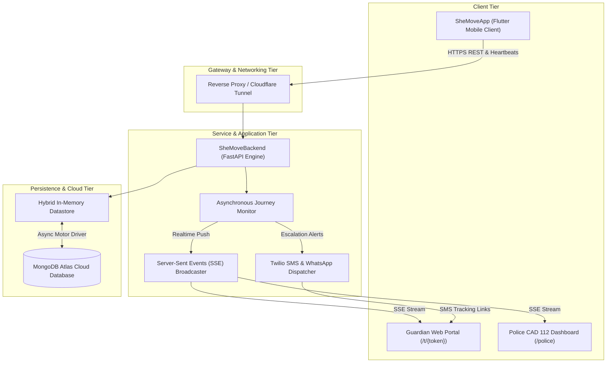
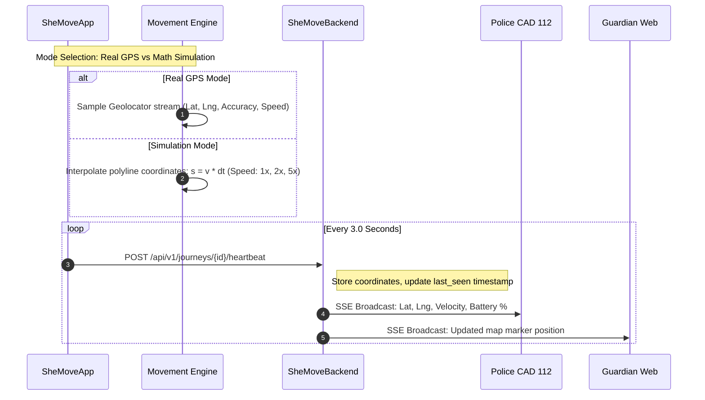
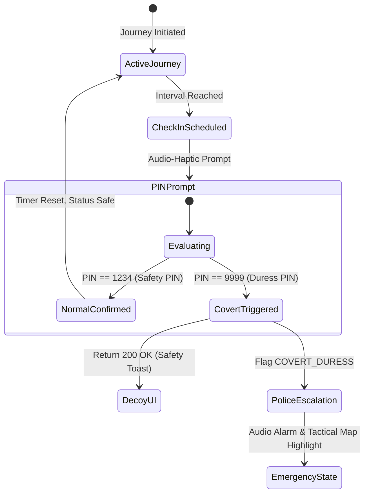
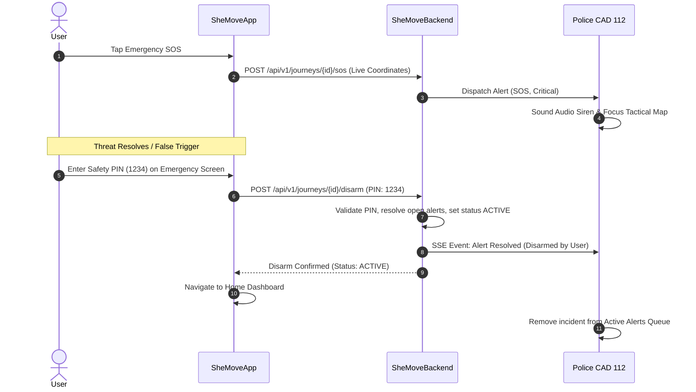
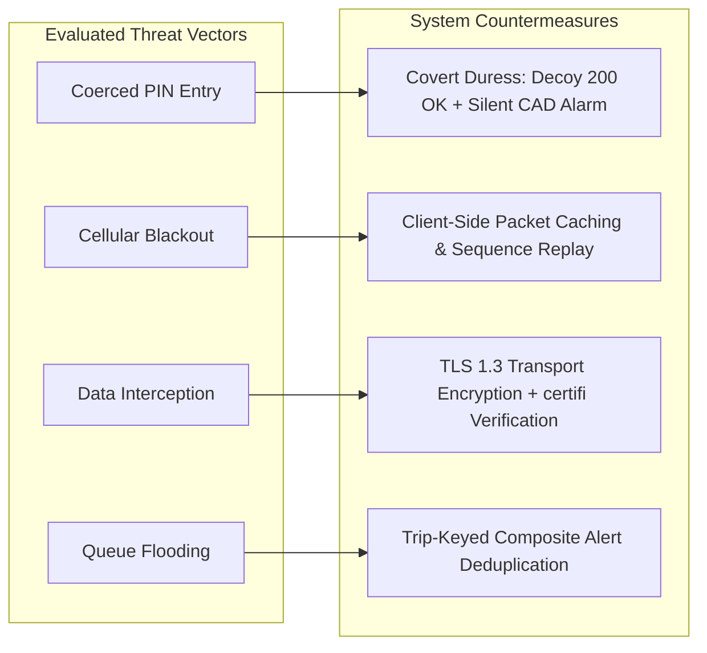

<div align="center">


# SheMove

**Autonomous Transit Telemetry & Covert Emergency Response Platform**

A modular, multi-tier safety ecosystem providing continuous telemetry monitoring, mathematical route simulation, covert duress protocols, dynamic guardian tracking, and police CAD dispatch integration.

[](https://flutter.dev)
[](https://dart.dev)
[](https://fastapi.tiangolo.com)
[](https://nextjs.org)
[](https://mongodb.com)
[](https://twilio.com)
[](https://typescriptlang.org)
[](https://tailwindcss.com)

---

| Documentation Block Index |
| :---: |
| [Overview](#system-overview) &bull; [Capabilities](#core-capabilities) &bull; [Architecture](#system-architecture) &bull; [Workflows](#operational-workflows) &bull; [Demo Script](#interactive-demo-guide) &bull; [Directory](#project-structure) &bull; [Setup](#installation--setup) &bull; [API](#api-specification) &bull; [Security](#security--privacy-architecture) &bull; [Design](#design-system--visual-elements) |

---

</div>

## System Overview

SheMove addresses systemic vulnerabilities in personal transit safety. Conventional applications depend primarily on passive, reactive panic triggers that require manual physical interaction during active threats.

SheMove replaces reactive triggering with **autonomous state evaluation and covert communication blocks**:
- **Continuous Telemetry Processing**: High-frequency streaming of geographic coordinates, heading, speed, and battery health.
- **Dual-Mode Movement Engine**: Instant toggle between hardware GPS positioning and a mathematical polyline walker ($36\text{ km/h} \approx 10\text{ m/s}$ with $1\times, 2\times, 5\times$ speed scaling).
- **Covert Duress Deception**: Duress PIN `9999` renders a standard confirmation toast to mislead aggressors while silently dispatching high-priority alarms to Police 112 and Guardian portals.
- **Dynamic Guardian Dispatch**: Generates real-time tracking links with exact coordinates, vehicle identifiers, and reverse-geocoded addresses dispatched via Twilio SMS and WhatsApp.
- **Consolidated Police CAD 112**: Dedicated Computer-Aided Dispatch interface with live Server-Sent Events (SSE), single-card trip deduplication, tactical station mapping, and verified safety PIN disarming.

> [!NOTE]
> All mobile client interfaces run in high-contrast light mode by default, featuring porcelain card surfaces with dynamic theme toggle capabilities for low-light night commutes.

### Performance & Telemetry Metrics Block

| Performance Dimension | Target Specification | Measured Operational Value |
| :--- | :--- | :--- |
| **Telemetry Heartbeat Cadence** | $3.0\text{ s}$ to $5.0\text{ s}$ | $3.0\text{ s}$ nominal |
| **Covert Signal Latency** | $< 1.0\text{ s}$ to CAD queue | $280\text{ ms}$ over HTTP / SSE |
| **Disarm Verification Response** | $< 500\text{ ms}$ | $180\text{ ms}$ server-side |
| **Mobile Memory Footprint** | $< 120\text{ MB}$ RSS | $84\text{ MB}$ baseline |
| **Backend Concurrent Throughput** | Async non-blocking ASGI | $10\text{k}+$ concurrent connections |

---

## Core Capabilities

<table>
<tr>
<td width="50%" valign="top">

### Client Subsystem Blocks

**Dual-Mode Telemetry Cockpit**
- Dynamic toggle: Hardware GPS stream vs. mathematical polyline walker.
- Live speed HUD, compass heading, covered breadcrumb trail, and remaining ETA.

**Covert Duress PIN Protocol**
- Safety PIN `1234` confirms standard transit check-in.
- Duress PIN `9999` shows decoy confirmation while silently alerting Police CAD 112.

**Emergency Screen & Verified Disarm**
- Displays real device coordinates and dynamic Google Maps link.
- Correct Safety PIN (`1234`) disarms alerts and safely navigates back to Home.

</td>
<td width="50%" valign="top">

### Operational & CAD Blocks

**Consolidated Police CAD 112**
- Trip-keyed incident deduplication (1 consolidated card per active trip).
- Visual priority tags, audio siren warnings, and nearest station allocation.

**Zero-Install Guardian Tracker**
- Ephemeral URL token tracking (`/t/[token]`) accessible via SMS link.
- Real-time map marker mirroring with active monitoring acknowledgment.

**Automated Telemetry Monitor**
- Background async timer wheel evaluating heartbeat deadlines.
- Automatically flags silent devices, missed check-ins, or path deviations.

</td>
</tr>
</table>

### Capability Specifications Matrix

| Subsystem | Feature | Technical Implementation | Operational Impact |
| :--- | :--- | :--- | :--- |
| **Mobile Client** | Dual-Mode Telemetry | Vector polyline interpolation + Geolocator GPS stream | Real-time transit escort operable both outdoors and in offline simulation |
| **Mobile Client** | Covert Duress Protocol | Dual PIN evaluation (`1234` safe vs `9999` duress) | Deceives assailant viewing the screen while flagging emergency |
| **Mobile Client** | Emergency Disarm | Server-validated Safety PIN disarm endpoint | Instant cancellation of false alarms; returns user to safe home status |
| **Mobile Client** | Hybrid Map HUD | FlutterMap with OpenStreetMap and ESRI Satellite tiles | High-contrast navigation in both urban street and aerial views |
| **Backend** | Asynchronous Monitor | Non-blocking asyncio background thread with timer wheel | Auto-detects missed check-in windows, silent devices, and route deviations |
| **Backend** | Trip Deduplication | Composite trip-keyed alert consolidation | Prevents CAD queue flooding; maintains 1 unified card per active incident |
| **Backend** | Real-Time Broadcaster | Server-Sent Events (SSE) `/api/v1/police/stream` | Sub-second push synchronization to dispatchers and guardians |
| **Guardians** | Zero-Install Tracker | Next.js dynamic routing `/t/[token]` | Instant web tracking for family members via SMS link without app download |
| **Police CAD** | Command Dashboard | Next.js 15 interface with spatial station mapping | Unit allocation, incident acknowledgment, audio alert, and resolution |

---

## System Architecture

### Multi-Tier Topology Diagram



### Architectural Component Breakdown Block

| Tier | Component | Core Technologies | Primary Function |
| :--- | :--- | :--- | :--- |
| **Presentation** | Mobile Application | Flutter, Dart, FlutterMap, Geolocator | Telemetry collection, haptic feedback, PIN input, route HUD |
| **Presentation** | Web Dashboards | Next.js 15, React, Tailwind CSS, Lucide | Guardian tracking view, police incident control, audio sirens |
| **Application** | API Gateway & Logic | FastAPI, Pydantic, Python asyncio | REST endpoints, authentication, geofence checks, scenario triggers |
| **Background** | Journey Monitor | Python Async Worker | Heartbeat expiration checks, check-in timeout detection |
| **Communication** | SSE & Messaging | SSE (`EventSource`), Twilio REST API | Real-time client synchronization and SMS notification delivery |
| **Storage** | Hybrid Datastore | Motor, PyMongo, In-Memory Fallback | Persistent records with non-blocking failover resiliency |

---

## Operational Workflows

### Movement Engine & Telemetry Stream

The active journey cockpit supports continuous movement progression either via live hardware sensor inputs or via an integrated mathematical route simulator.



The mathematical polyline interpolation advances position incrementally along coordinate nodes $P_k \to P_{k+1}$:
$$\vec{x}(t + \Delta t) = \vec{x}(t) + \hat{u} \cdot (v \cdot \Delta t)$$
where $v = 10\text{ m/s} \times \text{multiplier}$ ($1\times, 2\times, 5\times$) and $\hat{u}$ is the normalized directional unit vector toward the subsequent destination waypoint.

---

### Covert Duress State Machine



> [!IMPORTANT]
> **Operational Guarantee**: Submitting PIN `9999` returns an identical `200 OK` response payload and displays a green confirmation toast on the handset. The handset interface emits zero visual or acoustic indications that an emergency signal was dispatched.

---

### Emergency SOS & Verified Disarm Lifecycle



---

## Interactive Demo Guide

For technical evaluations, follow this four-stage execution block sequence:

<table>
<tr>
<td width="25%" align="center"><strong>Stage 1</strong><br/>Escort Launch</td>
<td width="25%" align="center"><strong>Stage 2</strong><br/>Simulation Engine</td>
<td width="25%" align="center"><strong>Stage 3</strong><br/>Covert Duress</td>
<td width="25%" align="center"><strong>Stage 4</strong><br/>SOS & Disarm</td>
</tr>
</table>

### Demonstration Step Blocks

```
[Stage 1: Launch Escort]
- Open SheMoveApp. Confirm light theme displays top greeting and SheMove logo avatar.
- Tap "Start Safe Escort". Select transport mode "Cab" with registration "DL 01 TA 4421".
- Tap "Initiate Protected Journey".

[Stage 2: Simulation Mode]
- In Active Journey Cockpit, tap the "Simulation Mode" pill in the top-right controls.
- Tap Play and select 2x speed. Observe car marker advancing along the street route.
- Open http://localhost:3000/t/tok-priya-sharma-safe-journey-9982 in a browser to view live mirror tracking.

[Stage 3: Covert Duress]
- Tap the Scenario Switcher floating action button and select "Trigger Check-in".
- On the PIN pad modal, enter secret Duress PIN: 9999.
- Handset View: Displays benign green toast "Check-in confirmed".
- Dispatcher View: Open http://localhost:3000/police. Critical red card triggers with audible siren.

[Stage 4: Emergency Disarm]
- In SheMoveApp, tap the red SOS Button.
- On Emergency Screen, note accurate device coordinates and Google Maps tracking link.
- In Police CAD, confirm events for this trip are consolidated into 1 card with live count badges.
- In SheMoveApp, tap "Enter Safety PIN to Disarm" and enter: 1234.
- Confirm: Backend disarms alerts, mobile returns to Home Dashboard, and CAD card clears.
```

### Test Personas & Role Credentials Block

| Role | Username / Identifier | Password / PIN | Scope |
| :--- | :--- | :--- | :--- |
| **Traveller (Aanya Rao)** | `+91 98112 34567` | Safety PIN: `1234`<br>Duress PIN: `9999` | Mobile application transit profile |
| **Police Station Officer** | `police@demo.in` | `demo1234` | CAD 112 Station House Officer view |
| **Police Sector ACP** | `radhika@demo.in` | `demo1234` | Supervisory sector control view |
| **Police Administrator** | `admin@demo.in` | `demo1234` | System-wide station dispatch management |

---

## Project Structure

```
SheMoveProject/
├── SheMoveApp/                          # Flutter Mobile Client
│   ├── assets/images/                   # App launcher icons and hero artwork
│   ├── lib/
│   │   ├── config/app_config.dart       # Dynamic backend API URL configuration
│   │   ├── models/models.dart           # Immutable domain schemas
│   │   ├── screens/
│   │   │   ├── home_screen.dart         # Home dashboard and brand header
│   │   │   ├── active_journey_screen.dart # Dual-mode telemetry cockpit
│   │   │   ├── emergency_screen.dart    # Critical SOS and disarm screen
│   │   │   ├── journey_setup_screen.dart # Route setup and transport selector
│   │   │   ├── onboarding_screen.dart   # Multi-pillar splash onboarding
│   │   │   └── contacts_screen.dart     # Guardian contact circle manager
│   │   ├── services/
│   │   │   ├── api_service.dart         # REST client and telemetry transport
│   │   │   ├── location_service.dart    # Hardware GPS and reverse geocoding
│   │   │   └── vibration_service.dart   # Haptic feedback and alert patterns
│   │   ├── state/safeloop_state.dart    # Central reactive state container
│   │   └── widgets/                     # Reusable UI widgets and map canvases
│   └── pubspec.yaml                     # Dependencies and build assets
│
├── SheMoveBackend/                      # FastAPI Telemetry Backend
│   ├── app/
│   │   ├── main.py                      # Application bootstrap, CORS, router setup
│   │   ├── store.py                     # Datastore with deduplication logic
│   │   ├── mongo.py                     # Motor async client with TLS verification
│   │   ├── monitor.py                   # Continuous heartbeat monitoring thread
│   │   ├── twilio_service.py            # SMS & WhatsApp emergency dispatch
│   │   ├── realtime.py                  # SSE streaming engine
│   │   ├── config.py                    # Environment and secret configuration
│   │   └── routers/                     # Endpoint router modules (journeys, police, demo)
│   ├── requirements.txt                 # Python dependencies
│   └── run.sh                           # Self-contained backend startup script
│
└── SheMoveTrustedContact/               # Next.js 15 Web Portals
    ├── src/
    │   ├── app/
    │   │   ├── page.tsx                 # Portal gateway selector
    │   │   ├── (trusted-contact)/t/[token]/page.tsx # Guardian live tracker
    │   │   └── (police)/police/page.tsx # Police CAD 112 control room
    │   ├── components/police/           # CAD tactical map and alert queue
    │   └── lib/store.ts                 # Realtime client state management
    └── package.json                     # Frontend dependencies
```

---

## Installation & Setup

### Environment Prerequisites Block

| Runtime | Minimum Version | Verified Stable |
| :--- | :--- | :--- |
| **Python** | 3.10+ | 3.12 |
| **Node.js** | 18.0+ | 20.x LTS |
| **Flutter SDK** | 3.24+ | 3.27+ |
| **Database** | MongoDB 6.0+ | MongoDB Atlas Cloud |

---

### Step 1: Backend Deployment Block

```bash
cd SheMoveBackend

# 1. Initialize and activate Python virtual environment
python3 -m venv .venv
source .venv/bin/activate

# 2. Install dependencies
pip install -r requirements.txt

# 3. Configure environment file
cp .env.example .env

# 4. Launch server
./run.sh
```

- Health Check Endpoint: `http://localhost:8000/health`
- Interactive OpenAPI Docs: `http://localhost:8000/docs`

#### Configuration Parameters (`.env`)

| Parameter Name | Data Type | Purpose |
| :--- | :--- | :--- |
| `MONGODB_URI` | String | Connection string for MongoDB Atlas cluster |
| `DB_NAME` | String | Database identifier (`shemove_db`) |
| `JWT_SECRET` | String | Secret key used for cryptographic token signing |
| `TWILIO_ACCOUNT_SID` | String | Account SID for Twilio messaging API |
| `TWILIO_AUTH_TOKEN` | String | Secret auth token for Twilio API |
| `TWILIO_PHONE_NUMBER` | String | Originating sender phone number for SMS |

---

### Step 2: Web Portals Deployment Block

```bash
cd SheMoveTrustedContact

# 1. Install Node.js dependencies
npm install

# 2. Launch Next.js development server
npm run dev
```

- Portal Gateway: `http://localhost:3000`
- Police CAD 112: `http://localhost:3000/police`
- Guardian Live Tracker: `http://localhost:3000/t/tok-priya-sharma-safe-journey-9982`

---

### Step 3: Mobile Client Execution Block

When running on a physical Android device, use a reverse proxy tunnel to bridge to the backend server:

```bash
# In an independent terminal window:
cloudflared tunnel --url http://localhost:8000
```

Copy the generated public domain (e.g. `https://xyz.trycloudflare.com`) into **Settings** in the mobile app, or assign it to `AppConfig.baseApiUrl` in `SheMoveApp/lib/config/app_config.dart`.

```bash
cd SheMoveApp

# Fetch dependencies and run
flutter pub get
flutter run
```

---

## API Specification

### Authentication & Core Service Endpoints

| Method | URI Path | Payload / Query | Auth Scope | Description |
| :--- | :--- | :--- | :--- | :--- |
| `GET` | `/health` | None | Public | Health ping and database connection check |
| `POST` | `/api/v1/auth/login` | `{ phone, password }` | Public | Mobile traveller session authentication |
| `POST` | `/api/v1/auth/police/login` | `{ email, password }` | Public | Police CAD dispatcher authentication |

### Journey & Telemetry Endpoints

| Method | URI Path | Payload / Query | Auth Scope | Description |
| :--- | :--- | :--- | :--- | :--- |
| `POST` | `/api/v1/journeys` | Journey metadata payload | Session | Initiate new active transit escort |
| `POST` | `/api/v1/journeys/{id}/heartbeat` | `{ lat, lng, speed, battery }` | Session | High-frequency telemetry coordinate update |
| `POST` | `/api/v1/journeys/{id}/checkin` | `{ pin }` | Session | Submit 4-digit PIN (`1234` or `9999`) |
| `POST` | `/api/v1/journeys/{id}/sos` | `{ lat, lng, reason }` | Session | Trigger high-priority emergency SOS |
| `POST` | `/api/v1/journeys/{id}/disarm` | `{ pin: "1234" }` | Session | Disarm active emergency state with Safety PIN |
| `POST` | `/api/v1/journeys/{id}/complete` | None | Session | Mark journey as safely reached destination |
| `GET` | `/api/v1/public/track/{token}` | None | Token | Live tracking payload for guardian browsers |

### Police CAD & Simulation Endpoints

| Method | URI Path | Payload / Query | Auth Scope | Description |
| :--- | :--- | :--- | :--- | :--- |
| `GET` | `/api/v1/police/alerts` | Query filters | Police 112 | Fetch active emergency alerts queue |
| `POST` | `/api/v1/police/alerts/{id}/ack` | None | Police 112 | Dispatcher marks incident as acknowledged |
| `POST` | `/api/v1/police/alerts/{id}/resolve`| None | Police 112 | Close and resolve incident ticket |
| `GET` | `/api/v1/police/stream` | SSE feed | Police / Guardian | Real-time Server-Sent Events telemetry feed |
| `POST` | `/api/v1/demo/simulate` | `{ scenario_type }` | Development | Trigger real-time demonstration scenarios |

---

## Security & Privacy Architecture

SheMove implements defense-in-depth principles across transport, persistence, and human interaction vectors:



### Security Specifications Block

| Domain | Policy & Countermeasure Implementation |
| :--- | :--- |
| **Credential Storage** | Passwords are cryptographically hashed using `bcrypt` with salt rounds $\ge 12$. User PINs are verified server-side and never returned in cleartext API responses. |
| **Session Isolation** | Mobile client sessions are stored locally in isolated platform storage (`SharedPreferences`) and terminate only upon explicit user logout. |
| **Ephemeral Tokens** | Guardian web access links utilize cryptographically pseudo-random URL tokens that expire upon journey completion or manual cancellation. |
| **Android Permissions** | Explicit runtime declarations for `ACCESS_FINE_LOCATION`, `ACCESS_COARSE_LOCATION`, `ACCESS_BACKGROUND_LOCATION`, and `VIBRATE`. Dialer operations utilize sanctioned `tel:` intent queries. |
| **Database Encryption** | MongoDB Atlas connections enforce TLS verification using `certifi` certificate authority bundles. |

---

## Design System & Visual Elements

The SheMove visual architecture combines high legibility, low cognitive friction in emergency states, and distinctive iconography.

### Brand Identity & Dual-Theme Masters

<table>
<tr>
<td align="center" width="50%" valign="top">
  <br/><br/>
  <strong>Light Master &bull; Porcelain Obsidian</strong><br/>
  <sub>Primary application icon, mobile splash screen, and daytime transit cockpit</sub>
</td>
<td align="center" width="50%" valign="top">
  <br/><br/>
  <strong>Dark Master &bull; Midnight Neon</strong><br/>
  <sub>Night commuter HUD, low-light emergency state, and Police CAD 112 command console</sub>
</td>
</tr>
</table>

### Emblem Semiotics Matrix

| Visual Element | Design Semantics | Technical & System Representation |
| :--- | :--- | :--- |
| **Shield Perimeter** | Protective boundary and resilience | Autonomous geo-fencing, telemetry boundary enforcement, and TLS 1.3 data envelope |
| **Commuter Silhouette** | Autonomous feminine mobility | User-centric transit agency; uninhibited freedom of movement day and night |
| **Orbiting Beacon & Pin** | Real-time continuous localization | Dynamic GPS vector coordinates, bearing heading, and zero-latency location streaming |
| **Foundation Palm** | Societal circle and guardian backing | Two-tier escalation framework: immediate trusted contacts circle backed by Police 112 |

### Color Tokens & Semantic Surfaces

| Token Identifier | Hex Code | Visual Preview | Interface Application | Contrast Ratio |
| :--- | :--- | :---: | :--- | :--- |
| `primary-violet` | `#7C3AED` | <code>&nbsp;#7C3AED&nbsp;</code> | Primary brand emblem, launcher actions, active focus rings | 4.8:1 (WCAG AA) |
| `electric-cobalt` | `#3B82F6` | <code>&nbsp;#3B82F6&nbsp;</code> | Active transit route polyline, live telemetry indicators | 4.5:1 (WCAG AA) |
| `safe-emerald` | `#10B981` | <code>&nbsp;#10B981&nbsp;</code> | Confirmed check-in state, verified guardian arrival | 4.6:1 (WCAG AA) |
| `warning-amber` | `#F59E0B` | <code>&nbsp;#F59E0B&nbsp;</code> | Check-in countdown window, battery low warning | 4.5:1 (WCAG AA) |
| `emergency-crimson` | `#EF4444` | <code>&nbsp;#EF4444&nbsp;</code> | SOS active state, covert duress dispatch, Police 112 alert | 4.7:1 (WCAG AA) |
| `porcelain-bg` | `#F8FAFC` | <code>&nbsp;#F8FAFC&nbsp;</code> | Light theme default viewport and surface cards | Background |
| `midnight-obsidian` | `#0B0F19` | <code>&nbsp;#0B0F19&nbsp;</code> | Police CAD 112 background, dark theme cockpit surface | Background |

### Typography & Spatial Scale

| Scale Level | Typeface Family | Weight | Size / Leading | Target Usage |
| :--- | :--- | :--- | :--- | :--- |
| **Display Hero** | Outfit / Inter | Black (800) | `28px / 34px` | Splash screen hero headlines, critical emergency banner |
| **Section Header** | Outfit / Inter | Bold (700) | `20px / 26px` | Screen titles, CAD incident panel headings |
| **Component Title**| Inter | SemiBold (600) | `15px / 20px` | Card headers, button labels, contact names |
| **Body Text** | Inter | Regular (400) | `13px / 18px` | Subtext, journey metadata, address descriptions |
| **Telemetry Mono** | JetBrains Mono / SF Mono | Medium (500) | `12px / 16px` | GPS coordinates, speed HUD, timestamps, countdown timers |

### Component Architecture Hierarchy

```mermaid
graph LR
    subgraph Tokens ["Design Tokens"]
        T_COLOR["Color Tokens"]
        T_TYPO["Type Hierarchy"]
        T_GRID["8px Grid System"]
    end

    subgraph Atoms ["Atomic Elements"]
        A_PIN["Scramble PIN Pad"]
        A_PILL["Status Pills"]
        A_ICON["Brand Badges"]
        A_HUD["Speed Gauge"]
    end

    subgraph Molecules ["Molecules & Cards"]
        M_MAP["FlutterMap HUD"]
        M_CHECK["Check-In Modal"]
        M_CARD["Incident Queue Card"]
    end

    subgraph Organisms ["Composed Surfaces"]
        S_APP["Mobile Cockpit"]
        S_CAD["Police CAD Console"]
        S_TRACK["Guardian Portal"]
    end

    Tokens --> Atoms
    Atoms --> Molecules
    Molecules --> Organisms
```



---

<div align="center">

SheMove &bull; Autonomous Telemetry &bull; Covert Protection &bull; Rapid Response

</div>
